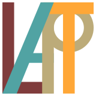

# Despre ghid

Ghidul este realizat și oferit de **coVR**, în parteneriat cu **Liceul de Arte Plastice Timișoara**, în proiectul *Spații pentru sine* din programul *Școli creative 2026-2027*.

În proiect, elevii liceului construiesc în realitate virtuală spații personalizate, desenate cu Open Brush. Ghidul este resursa online de utilizare a căștilor și a aplicației Open Brush prevăzută în proiect pentru profesorul-custode, care facilitează accesul elevilor la căști între atelierele cu facilitatorii. E publicat ca **resursă deschisă**, pentru oricine lucrează cu Open Brush în română.

Conținutul ghidului aparține autorilor săi. Finanțatorul nu este responsabil pentru conținut.

<figure markdown>
[{ .covr }](https://covr.ro)
[{ .covr }](https://covr.ro)
<figcaption>Realizat de</figcaption>
</figure>
<figure markdown>
{ .lap }
<figcaption>În parteneriat cu</figcaption>
</figure>

{ .cdp }
{ .cdp }

Finanțat de Municipiul Timișoara prin Centrul de Proiecte și Administrația pentru Sănătate și Educație.

## Versiune

- Open Brush **v2.32**, pe **Meta Quest 3S** cu cureaua **BoboVR S3 Pro**.
- Ultima actualizare a ghidului: **octombrie 2026**.

Când Open Brush se actualizează și o funcție se schimbă, actualizăm pagina respectivă. Casetele galbene **„De verificat”** marchează detaliile care urmează să fie confirmate pe echipamentul proiectului.

## Surse

Informațiile despre Open Brush se bazează pe [documentația oficială](https://docs.openbrush.app) a Icosa Foundation, adaptată și rescrisă în română pentru lucrul la clasă. Informațiile despre echipament vin de la producători.

Open Brush este un proiect open-source al [Icosa Foundation](https://github.com/icosa-foundation). Acest ghid este independent și nu este afiliat Icosa Foundation, Meta sau BoboVR. Numele produselor aparțin deținătorilor lor.

## Licență

Textul ghidului este publicat sub licența [Creative Commons Atribuire 4.0 Internațional (CC BY 4.0)](https://creativecommons.org/licenses/by/4.0/deed.ro): îl poți copia, adapta și distribui, cu mențiunea sursei. Siglele coVR, Centrul de Proiecte și ASEMT nu intră sub această licență.

## Sugestii și corecturi

Ai găsit o greșeală sau lipsește ceva? Scrie-ne prin [covr.ro](https://covr.ro) sau deschide o [sesizare pe GitHub](https://github.com/MihatKonrad/ghid-open-brush/issues).
